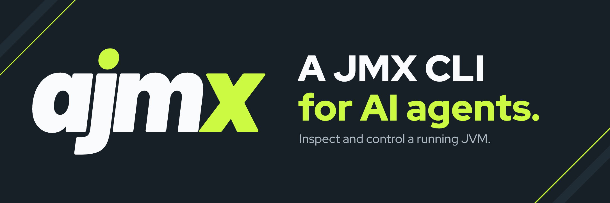

# ajmx



A JMX CLI for AI agents. It lists local JVMs and searches, describes, reads, writes and invokes MBeans on local and remote JVMs.

## Why

To look inside a running JVM, such as its heap, threads, connection pools or log levels, an agent has to go through JMX. The usual JMX tools are made for people. JDK Mission Control, VisualVM and jconsole are GUIs, and jmxterm prints text meant to be read, not parsed.

ajmx reads or changes a JVM in one command and prints the result as one JSON document.

- **No setup.** `--pid` connects to a local JVM even without remote JMX enabled. No restart or JVM flags.
- **JSON only.** Errors come as `error.code` and `retryable`, not stack traces.
- **Bounded output.** `--limit` and `--max-bytes` cap the output, and `truncated` marks what was cut.
- **Single binary.** A native binary. No JVM or daemon required.

## Install

On macOS (Apple silicon) and Linux (x86_64, arm64, with glibc 2.34 or later and zlib):

```sh
curl -fsSL https://github.com/yagipass/ajmx/releases/latest/download/install.sh | sh -s -- -b ~/.local/bin
# or
brew install yagipass/tap/ajmx
# or
nix profile install github:yagipass/ajmx
```

### Agent skill

[`skills/ajmx`](skills/ajmx/SKILL.md) teaches an agent how to explore a JVM with ajmx, when to change it, and how to read partial results and errors. Install it with one of:

```sh
gh skill install yagipass/ajmx ajmx
npx skills add yagipass/ajmx --skill ajmx
apm install yagipass/ajmx/skills/ajmx
```

## Usage

Select the target with `--pid <pid>` for a local JVM, even without remote JMX enabled, or `--url <url>` for a remote one, such as `service:jmx:rmi:///jndi/rmi://host:9010/jmxrmi`. `ajmx help` prints the usage as JSON.

```sh
ajmx ps
ajmx --pid 12345 search 'java.lang:*'
ajmx --pid 12345 describe java.lang:type=Memory
ajmx --pid 12345 read java.lang:type=Memory HeapMemoryUsage
ajmx --pid 12345 write com.example:type=Config MaxConnections=20
ajmx --pid 12345 invoke com.example:type=Cache invalidate --args '["user:123"]'
```

## Documentation

The [documentation site](https://ajmx.yagipass.com) has the rest.

| Page | What |
|---|---|
| [Quick start](https://ajmx.yagipass.com/quick-start/) | Install ajmx and its agent skill, then ask your agent about a running JVM |
| [Use cases](https://ajmx.yagipass.com/use-cases/) | Heap and GC, threads, connection pools, changing a setting and an application's own MBean, with real output |
| [Local JVMs](https://ajmx.yagipass.com/connect/local/), [remote JVMs](https://ajmx.yagipass.com/connect/remote/) | `--pid`, `--url`, credentials and TLS |
| [Commands](https://ajmx.yagipass.com/commands/), [batch](https://ajmx.yagipass.com/batch/), [options](https://ajmx.yagipass.com/options/) | Every command and option, and the fields of each result |
| [Output](https://ajmx.yagipass.com/output/), [errors and exit codes](https://ajmx.yagipass.com/errors/) | The JSON document, how JMX values map to JSON, what `--limit` and `--max-bytes` cut, and which errors to retry |
| [Troubleshooting](https://ajmx.yagipass.com/troubleshooting/), [limitations](https://ajmx.yagipass.com/limitations/) | Fixes for connection errors, and what ajmx cannot read, send or attach to |
| [Verifying downloads](https://ajmx.yagipass.com/verify/) | Checking that a downloaded binary is the one ajmx released |

## Development

See [CONTRIBUTING.md](CONTRIBUTING.md).

## License

ajmx is licensed under the [Apache License, Version 2.0](LICENSE).
